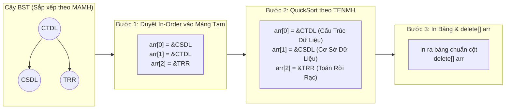
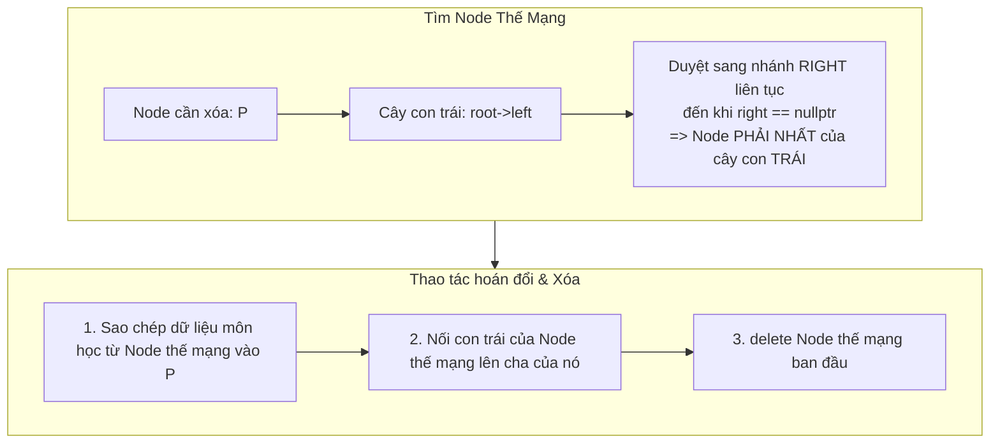

# BÁO CÁO KỸ THUẬT & PHÂN TÍCH MÃ NGUỒN CHI TIẾT
## HỆ THỐNG QUẢN LÝ ĐIỂM SINH VIÊN THEO HỆ TÍN CHỈ (PTIT)
**Học phần:** Cấu trúc Dữ liệu & Giải thuật — Học kỳ 1, Năm học 2026 - 2027  
**Dành riêng cho:** **Ngô Quang Thọ** (Trưởng nhóm — MSSV: `N24DECE043`)  
**Thành viên:** Bùi Ngọc An (`N24DECE001`), Lê Thành Long (`N24DECE028`)  

---

## MỤC LỤC CHI TIẾT
1. [TỔNG QUAN KIẾN TRÚC & QUY TẮC PHÁT TRIỂN](#1-tổng-quan-kiến-trúc--quy-tắc-phát-triển)
2. [PHÂN TÍCH CODE CHUYÊN SÂU 5 CẤU TRÚC DỮ LIỆU CỐT LÕI](#2-phân-tích-code-chuyên-sâu-5-cấu-trúc-dữ-liệu-cốt-lõi)
3. [PHÂN TÍCH CHI TIẾT TỪNG DÒNG CODE CỦA CÁC GIẢI THUẬT QUAN TRỌNG](#3-phân-tích-chi-tiết-từng-dòng-code-của-các-giải-thuật-quan-trọng)
   - [3.1. Giải thuật In Cây Môn Học Tăng Dần Theo Tên (In-Order Traversal + QuickSort)](#31-giải-thuật-in-cây-môn-học-tăng-dần-theo-tên-in-order-traversal--quicksort)
   - [3.2. Giải thuật Xóa Node Trên Cây BST (Kỹ thuật Node Thế Mạng 2 Con)](#32-giải-thuật-xóa-node-trên-cây-bst-kỹ-thuật-node-thế-mạng-2-con)
   - [3.3. Giải thuật Chèn Sinh Viên Có Thứ Tự Tên + Họ trên DSLK Đơn](#33-giải-thuật-chèn-sinh-viên-có-thứ-tự-tên--họ-trên-dslk-đơn)
   - [3.4. Xử lý Lệch Thứ Tự Alphabet khi Hiệu Chỉnh Sinh Viên](#34-xử-lý-lệch-thứ-tự-alphabet-khi-hiệu-chỉnh-sinh-viên)
   - [3.5. Giải thuật In DSSV Theo Mã SV (Tách Mảng Con Trỏ + QuickSort)](#35-giải-thuật-in-dssv-theo-mã-sv-tách-mảng-con-trỏ--quicksort)
   - [3.6. Giải thuật Mở Lớp Tín Chỉ & Cấp Mã Tự Động Tăng](#36-giải-thuật-mở-lớp-tín-chỉ--cấp-mã-tự-động-tăng)
   - [3.7. Nghiệp Vụ Đăng Ký Lớp Tín Chỉ & Cơ Chế Soft-Delete](#37-nghiệp-vụ-đăng-ký-lớp-tín-chỉ--cơ-chế-soft-delete)
   - [3.8. Giải thuật Lọc & Hủy Lớp Tín Chỉ Không Đủ Sĩ Số](#38-giải-thuật-lọc--hủy-lớp-tín-chỉ-không-đủ-sĩ-số)
   - [3.9. Giải thuật Nhập Điểm & Sắp Xếp Nội Bộ Bằng Insertion Sort](#39-giải-thuật-nhập-điểm--sắp-xếp-nội-bộ-bằng-insertion-sort)
   - [3.10. Giải thuật Tính Điểm Trung Bình Khóa Học Tích Lũy (Chỉ Lấy Điểm Max)](#310-giải-thuật-tính-điểm-trung-bình-khóa-học-tích-lũy-chỉ-lấy-điểm-max)
   - [3.11. Giải thuật Ma Trận Bảng Điểm Tổng Kết & Phân Trang Chống Vỡ Khung](#311-giải-thuật-ma-trận-bảng-điểm-tổng-kết--phân-trang-chống-vỡ-khung)
   - [3.12. Cơ Chế Ghi File An Toàn Nguyên Tử (Atomic File I/O)](#312-cơ-chế-ghi-file-an-toàn-nguyên-tử-atomic-file-io)
4. [BẢNG TỔNG HỢP BIG-O THỜI GIAN & KHÔNG GIAN BỘ NHỚ](#4-bảng-tổng-hợp-big-o-thời-gian--không-gian-bộ-nhớ)
5. [BỘ CÂU HỎI VẤN ĐÁP BẢO VỆ ĐỒ ÁN DÀNH CHO TRƯỞNG NHÓM THỌ](#5-bộ-câu-hỏi-vấn-đáp-bảo-vệ-đồ-án-dành-cho-trưởng-nhóm-thọ)

---

## 1. TỔNG QUAN KIẾN TRÚC & QUY TẮC PHÁT TRIỂN

Toàn bộ dự án tuân thủ nghiêm ngặt **Quy tắc phát triển (Rules)**:
- **Thuần C/C++:** Không sử dụng bất kỳ container thư viện có sẵn nào (`vector`, `map`, `list`, `set`) hay hàm sắp xếp có sẵn (`std::sort`). Mọi cấu trúc và thuật toán đều tự viết bằng con trỏ thuần.
- **Tách biệt 2 tầng:**
  - **Tầng Backend (Core Engine):** Chứa toàn bộ struct dữ liệu và các hàm xử lý thuật toán (`src/monhoc.cpp`, `src/lop.cpp`, `src/sinhvien.cpp`, `src/loptc.cpp`, `src/dangky.cpp`, `src/diem.cpp`, `src/rang_buoc.cpp`, `src/file_io.cpp`, `src/utils.cpp`).
  - **Tầng Frontend (Dual UI):** Console giao diện dòng lệnh truyền thống (`src/main.cpp`) và Giao diện đồ họa Qt6 (`src/gui/`).
- **Quản lý dữ liệu tập trung:** Mô hình Singleton `AppData` điều phối nạp dữ liệu lúc khởi động và tự động lưu, giải phóng RAM khi thoát ứng dụng.

---

## 2. PHÂN TÍCH CODE CHUYÊN SÂU 5 CẤU TRÚC DỮ LIỆU CỐT LÕI

Khai báo trong file [`include/struct.h`](file:///d:/PTIT/DSA/include/struct.h):

### 2.1. Cây nhị phân tìm kiếm Môn học (BST)
```cpp
struct MonHoc {
    char MAMH[11];   // Khóa tìm kiếm (tối đa 10 ký tự + null)
    char TENMH[51];  // Tên môn học
    int STCLT;       // Số tín chỉ lý thuyết (>= 0)
    int STCTH;       // Số tín chỉ thực hành (>= 0)
};

struct nodeMonHoc {
    MonHoc mh;
    nodeMonHoc *left = nullptr;   // Con trỏ nhánh trái (< MAMH)
    nodeMonHoc *right = nullptr;  // Con trỏ nhánh phải (> MAMH)
};
typedef nodeMonHoc *TreeMonHoc;

struct DS_MonHoc {
    TreeMonHoc root = nullptr;
    int n = 0; // Biến đếm tổng số môn học trong cây
};
```
- **Bản chất bộ nhớ:** Cấp phát động từng node trên Heap. Tìm kiếm/thêm mới trung bình đạt $O(\log N)$.
- **Khóa so sánh:** `MAMH` dùng hàm `stricmp` (so sánh không phân biệt hoa thường).

### 2.2. Danh sách Lớp sinh viên: Danh sách tuyến tính mảng đặc
```cpp
struct LOPSV {
    char MALOP[16];          // Khóa chính lớp (vd: D24CQCN01)
    char TENLOP[51];         // Tên đầy đủ
    PTRSV FirstSV = nullptr; // Con trỏ đầu DSLK đơn sinh viên của lớp
};

struct DS_LOPSV {
    int n = 0;                      // Số lượng lớp hiện tại
    LOPSV nodes[MAX_LOPSV];         // Mảng tĩnh 10.000 phần tử (MAX_LOPSV = 10000)
};
```
- **Cơ chế:** Mảng đặc chứa các phần tử lớp liên tiếp nhau trong bộ nhớ. Mỗi lớp giữ một danh sách con trỏ `FirstSV` trỏ tới danh sách sinh viên thuộc lớp.

### 2.3. Danh sách Sinh viên: Danh sách liên kết đơn
```cpp
struct SinhVien {
    char MASV[16];   // Khóa chính duy nhất toàn trường
    char HO[51];     // Họ và tên đệm
    char TEN[16];    // Tên
    char PHAI[4];    // NAM hoặc NU
    char SODT[16];   // Số điện thoại liên hệ
};

struct nodeSV {
    SinhVien sv;
    nodeSV *next = nullptr; // Con trỏ trỏ tới sinh viên kế tiếp
};
typedef nodeSV *PTRSV;
```
- **Ràng buộc nghiệp vụ:** Không chèn tùy tiện vào cuối danh sách; mọi thao tác thêm sinh viên đều phải chèn có thứ tự tăng dần theo `Tên + Họ` (`InsertOrderSV`).

### 2.4. Danh sách Lớp tín chỉ: Mảng con trỏ tuyến tính
```cpp
struct LopTinChi {
    int MALOPTC;                  // Mã tự tăng (1, 2, 3...)
    char MAMH[11];                // Mã môn học (khóa ngoại trỏ về Cây BST)
    char NienKhoa[10];            // Định dạng: YYYY-YYYY (vd: 2025-2026)
    int HocKy;                    // 1..3
    int Nhom;                     // 1, 2, 3...
    int SoSVMin;                  // Sĩ số tối thiểu để mở lớp
    int SoSVMax;                  // Sĩ số tối đa
    bool HuyLop;                  // true = lớp bị hủy, false = đang mở
    PTR_DangKy FirstDK = nullptr; // Con trỏ đầu DSLK sinh viên đăng ký lớp
};

struct DS_LopTC {
    int n = 0;
    LopTinChi *nodes[MAX_LOPTC];  // Mảng chứa 10.000 CON TRỎ (MAX_LOPTC = 10000)
};
```
- **Tối ưu bộ nhớ vượt trội:** Ban đầu chỉ tốn $10000 \times 8 \text{ bytes} \approx 80 \text{ KB}$ cho mảng con trỏ. Chỉ khi mở lớp mới gọi `new LopTinChi`. Khi xóa/dồn mảng, ta chỉ hoán vị con trỏ 8 bytes chứ không phải copy cả struct to.

### 2.5. Danh sách Đăng ký: Danh sách liên kết đơn
```cpp
struct DangKy {
    char MASV[16];          // Mã sinh viên đăng ký
    float DIEM = -1;        // Điểm thi (-1.0f = chưa có điểm, 0.0 -> 10.0 = đã có điểm)
    bool HuyDangKy = false; // Soft-delete: false = đang học, true = đã hủy đăng ký
};

struct nodeDangKy {
    DangKy dk;
    nodeDangKy *next = nullptr;
};
typedef nodeDangKy *PTR_DangKy;
```

---

## 3. PHÂN TÍCH CHI TIẾT TỪNG DÒNG CODE CỦA CÁC GIẢI THUẬT QUAN TRỌNG

---

### 3.1. Giải thuật In Cây Môn Học Tăng Dần Theo Tên (In-Order Traversal + QuickSort)
*File nguồn:* [`src/monhoc.cpp`](file:///d:/PTIT/DSA/src/monhoc.cpp) — Hàm `InDanhSachMonHoc`

#### Vấn đề bài toán:
Cây BST môn học được phân cấp theo khóa **Mã Môn Học (`MAMH`)**. Nếu duyệt cây In-Order thuần túy, kết quả in ra sẽ tăng dần theo `MAMH`, chứ **không phải theo Tên môn học (`TENMH`)**. Nhưng đề bài yêu cầu in tăng dần theo Tên môn học.

#### Giải pháp kỹ thuật:
1. Cấp phát một mảng con trỏ tạm kích thước đúng bằng số môn học hiện có: `TreeMonHoc* arr = new TreeMonHoc[n]`.
2. Sử dụng giải thuật **Duyệt trung thứ tự (In-Order Traversal: Trái $\rightarrow$ Gốc $\rightarrow$ Phải)** để gom toàn bộ địa chỉ của $N$ node trên cây vào mảng `arr`.
3. Chạy thuật toán **QuickSort** sắp xếp lại các phần tử trong mảng con trỏ `arr` dựa trên tiêu chí so sánh `TENMH`.
4. Duyệt mảng `arr` để in bảng ra màn hình.
5. Giải phóng mảng con trỏ tạm: `delete[] arr` (chỉ hủy mảng con trỏ tạm, các node trên cây BST vẫn nguyên vẹn 100%).



#### Phân tích chi tiết từng đoạn code:

**Đoạn 1: Duyệt In-Order đưa con trỏ vào mảng**
```cpp
void InOrderTraversal(TreeMonHoc root, TreeMonHoc* arr, int &idx) {
    if (root != nullptr) {
        InOrderTraversal(root->left, arr, idx);  // 1. Duyệt hết cây con bên trái
        arr[idx++] = root;                       // 2. Lưu địa chỉ node hiện tại vào mảng
        InOrderTraversal(root->right, arr, idx); // 3. Duyệt hết cây con bên phải
    }
}
```
- `arr[idx++] = root`: Lưu con trỏ (8 bytes) thay vì copy cả struct `MonHoc`. Tốc độ cực nhanh và tiết kiệm RAM.

**Đoạn 2: QuickSort sắp xếp mảng con trỏ theo Tên môn học**
```cpp
void QuickSortMH(TreeMonHoc* arr, int low, int high) {
    if (low < high) {
        // KỸ THUẬT TRÁNH WORST CASE O(N^2):
        // Chọn pivot ở chính giữa mảng thay vì lấy phần tử cuối cùng
        int mid = low + (high - low) / 2;
        TreeMonHoc t = arr[mid]; arr[mid] = arr[high]; arr[high] = t;
        
        char* pivot = arr[high]->mh.TENMH;
        int i = (low - 1);

        for (int j = low; j <= high - 1; j++) {
            // So sánh chuỗi Tên môn học không phân biệt hoa thường
            if (stricmp(arr[j]->mh.TENMH, pivot) < 0) {
                i++;
                TreeMonHoc temp = arr[i];
                arr[i] = arr[j];
                arr[j] = temp;
            }
        }
        // Đưa pivot về đúng vị trí phân hoạch
        TreeMonHoc temp = arr[i + 1];
        arr[i + 1] = arr[high];
        arr[high] = temp;
        
        int pi = i + 1; // Vị trí chốt của pivot
        QuickSortMH(arr, low, pi - 1);  // Đệ quy nửa trái
        QuickSortMH(arr, pi + 1, high); // Đệ quy nửa phải
    }
}
```

**Đoạn 3: Điều phối và giải phóng bộ nhớ**
```cpp
void InDanhSachMonHoc(TreeMonHoc root, int n) {
    if (root == nullptr || n == 0) {
        cout << "[!] Danh sach mon hoc rong!\n";
        return;
    }
    
    // Cấp phát mảng con trỏ tạm
    TreeMonHoc* arr = new TreeMonHoc[n];
    int idx = 0;
    InOrderTraversal(root, arr, idx);
    
    // Sắp xếp nếu có từ 2 phần tử trở lên
    if (n > 1) QuickSortMH(arr, 0, n - 1);
    
    // In bảng ASCII với std::setw
    // ... (code in bảng) ...
    
    // BẮT BUỘC GIẢI PHÓNG MẢNG CON TRỎ TẠM ĐỂ TRÁNH RÒ RỈ BỘ NHỚ
    delete[] arr;
}
```

---

### 3.2. Giải thuật Xóa Node Trên Cây BST (Kỹ thuật Node Thế Mạng 2 Con)
*File nguồn:* [`src/monhoc.cpp`](file:///d:/PTIT/DSA/src/monhoc.cpp) — Hàm `XoaMonHoc`, `XoaMonHocNoiB`, `NodeTheMang`

#### Các trường hợp khi xóa node $P$ trên BST:
- **Trường hợp 1:** $P$ là node lá (không có con nào): Chỉ việc cho con trỏ cha trỏ về `nullptr` và `delete P`.
- **Trường hợp 2:** $P$ chỉ có 1 con (chỉ có con trái hoặc chỉ có con phải): Cho con trỏ cha nối thẳng tới con duy nhất của $P$, rồi `delete P`.
- **Trường hợp 3:** $P$ có đủ cả 2 con: Không thể xóa trực tiếp vì sẽ làm đứt toàn bộ liên kết bên dưới. Ta phải tìm một **Node thế mạng** để thay thế giá trị cho $P$.



#### Phân tích chi tiết code:

```cpp
// Hàm phụ trợ tìm node thế mạng bằng con trỏ tham chiếu
void NodeTheMang(TreeMonHoc &p, TreeMonHoc &rightMost) {
    if (rightMost->right != nullptr) {
        // Vẫn còn node lớn hơn ở nhánh phải -> tiếp tục đệ quy sang phải
        NodeTheMang(p, rightMost->right);
    } else {
        // Đã tìm thấy node phải nhất (giá trị lớn nhất trong cây con trái)
        p->mh = rightMost->mh;         // 1. Ghi đè dữ liệu môn học sang node cần xóa
        p = rightMost;                 // 2. Chuyển con trỏ p trỏ tới node thế mạng
        rightMost = rightMost->left;   // 3. Nối cây con trái của node thế mạng lên cha
    }
}

bool XoaMonHocNoiB(TreeMonHoc &root, const char MAMH[], int &n) {
    if (root == nullptr) return false;
    
    int cmp = stricmp(MAMH, root->mh.MAMH);
    if (cmp < 0) {
        return XoaMonHocNoiB(root->left, MAMH, n);  // Tìm tiếp bên trái
    } else if (cmp > 0) {
        return XoaMonHocNoiB(root->right, MAMH, n); // Tìm tiếp bên phải
    } else {
        // ĐÃ TÌM THẤY NODE CẦN XÓA
        TreeMonHoc p = root;
        
        if (root->left == nullptr) {
            root = root->right; // Trường hợp có 1 con phải hoặc node lá
        } else if (root->right == nullptr) {
            root = root->left;  // Trường hợp có 1 con trái
        } else {
            // Trường hợp có đủ 2 con: Tìm node phải nhất của cây con trái
            NodeTheMang(p, root->left);
        }
        delete p; // Giải phóng đúng node cần xóa (hoặc node thế mạng)
        n--;      // Giảm biến đếm số lượng môn học
        return true;
    }
}
```

---

### 3.3. Giải thuật Chèn Sinh Viên Có Thứ Tự Tên + Họ trên DSLK Đơn
*File nguồn:* [`src/sinhvien.cpp`](file:///d:/PTIT/DSA/src/sinhvien.cpp) — Hàm `InsertOrderSV`, `SoSanhTen`

#### Ràng buộc nghiệp vụ:
Đề bài quy định: Danh sách sinh viên thuộc mỗi lớp phải luôn được chèn sao cho **tăng dần theo Tên + Họ**. Nếu trùng Tên thì so sánh Họ. Nếu trùng cả Họ và Tên thì so sánh Mã SV.

#### Phân tích chi tiết code:

```cpp
int SoSanhTen(SinhVien a, SinhVien b) {
    int cmpTen = stricmp(a.TEN, b.TEN);
    if (cmpTen != 0) return cmpTen; // Ưu tiên 1: Tên
    
    int cmpHo = stricmp(a.HO, b.HO);
    if (cmpHo != 0) return cmpHo;   // Ưu tiên 2: Họ và tên đệm
    
    return stricmp(a.MASV, b.MASV); // Ưu tiên 3: Mã sinh viên (chống trùng lặp vị trí)
}

void InsertOrderSV(PTRSV &First, SinhVien sv) {
    // 1. Cấp phát node mới trên Heap
    PTRSV p = new nodeSV;
    p->sv = sv;
    p->next = nullptr;
    
    // 2. Trường hợp danh sách đang rỗng HOẶC chèn vào ngay đầu danh sách
    if (First == nullptr || SoSanhTen(First->sv, p->sv) > 0) {
        p->next = First;
        First = p;
        return;
    }
    
    // 3. Trường hợp chèn vào giữa hoặc cuối danh sách
    // Dùng con trỏ curr duyệt tìm node đứng ngay trước vị trí cần chèn
    PTRSV curr = First;
    while (curr->next != nullptr && SoSanhTen(curr->next->sv, p->sv) < 0) {
        curr = curr->next;
    }
    
    // Móc nối liên kết: Chèn p vào sau curr
    p->next = curr->next;
    curr->next = p;
}
```

---

### 3.4. Xử lý Lệch Thứ Tự Alphabet khi Hiệu Chỉnh Sinh Viên
*File nguồn:* [`src/sinhvien.cpp`](file:///d:/PTIT/DSA/src/sinhvien.cpp) — Hàm `SuaSV`

#### Tình huống biên (Edge Case) nguy hiểm:
Nếu sinh viên đang đứng ở vị trí vần "A" (An), sau đó người dùng sửa Tên thành "V" (Vinh). Nếu ta chỉ gán đè `strcpy(p->sv.TEN, "Vinh")`, danh sách liên kết sẽ **bị phá vỡ trật tự sắp xếp**.

#### Cách xử lý chuẩn thuật toán:
```cpp
// Trong hàm SuaSV:
if (stricmp(temp.TEN, p->sv.TEN) != 0 || stricmp(temp.HO, p->sv.HO) != 0) {
    // Nếu Tên hoặc Họ bị thay đổi -> Vị trí cũ trong DSLK bị sai!
    // Bước 1: Xóa ngầm node cũ ra khỏi danh sách
    XoaSVNoiB(First, MASV); 
    // Bước 2: Dùng lại thuật toán chèn có thứ tự để tìm vị trí mới chính xác
    InsertOrderSV(First, temp);
} else {
    // Nếu chỉ sửa Giới tính hoặc Số điện thoại -> Ghi đè tại chỗ an toàn
    p->sv = temp;
}
```

---

### 3.5. Giải thuật In DSSV Theo Mã SV (Tách Mảng Con Trỏ + QuickSort)
*File nguồn:* [`src/sinhvien.cpp`](file:///d:/PTIT/DSA/src/sinhvien.cpp) — Hàm `InDSSVTheoMa`

#### Vấn đề bài toán:
DSLK sinh viên đang có thứ tự theo **Tên + Họ** (Câu c). Đề bài câu d yêu cầu in ra màn hình theo **Mã SV (`MASV`)**. Ta không được phép thay đổi thứ tự các node trong DSLK gốc.

#### Giải thuật:
1. Đếm tổng số node trong DSLK $\rightarrow count$.
2. Cấp phát mảng con trỏ tạm: `PTRSV* arr = new PTRSV[count]`.
3. Quét DSLK một lượt để chép địa chỉ các node vào mảng: `arr[i++] = p`.
4. Gọi `QuickSortSV(arr, 0, count - 1)` sắp xếp mảng con trỏ theo `MASV`.
5. In kết quả ra màn hình.
6. `delete[] arr` giải phóng mảng tạm.

```cpp
void QuickSortSV(PTRSV* arr, int low, int high) {
    if (low < high) {
        // Chọn pivot ở giữa để tránh O(N^2) khi dữ liệu đã gần như có thứ tự
        int mid = low + (high - low) / 2;
        PTRSV t = arr[mid]; arr[mid] = arr[high]; arr[high] = t;
        
        char* pivot = arr[high]->sv.MASV;
        int i = (low - 1);
        for (int j = low; j <= high - 1; j++) {
            if (stricmp(arr[j]->sv.MASV, pivot) < 0) {
                i++;
                PTRSV temp = arr[i]; arr[i] = arr[j]; arr[j] = temp;
            }
        }
        PTRSV temp = arr[i + 1]; arr[i + 1] = arr[high]; arr[high] = temp;
        
        int pi = i + 1;
        QuickSortSV(arr, low, pi - 1);
        QuickSortSV(arr, pi + 1, high);
    }
}
```

---

### 3.6. Giải thuật Mở Lớp Tín Chỉ & Cấp Mã Tự Động Tăng
*File nguồn:* [`src/loptc.cpp`](file:///d:/PTIT/DSA/src/loptc.cpp) — Hàm `ThemLopTC`, `LayMaLopTCTuDong`

```cpp
// Cấp mã tự động tăng: Quét tìm mã lớn nhất hiện có + 1
int LayMaLopTCTuDong(const DS_LopTC &ds) {
    int maxId = 0;
    for (int i = 0; i < ds.n; i++) {
        if (ds.nodes[i] != nullptr && ds.nodes[i]->MALOPTC > maxId) {
            maxId = ds.nodes[i]->MALOPTC;
        }
    }
    return maxId + 1;
}

bool ThemLopTC(DS_LopTC &ds, LopTinChi ltc, TreeMonHoc rootMH) {
    if (ds.n >= MAX_LOPTC) return false;

    // 1. Validate niên khóa định dạng YYYY-YYYY (vd: 2025-2026)
    if (!KiemTraNienKhoaHopLe(ltc.NienKhoa)) return false;

    // 2. Validate môn học có tồn tại trên Cây BST môn học không
    if (TimMonHoc(rootMH, ltc.MAMH) == nullptr) return false;

    // 3. Validate trùng lặp bộ tứ (Niên khóa, Học kỳ, Mã MH, Nhóm)
    if (TimLopTCTrung(ds, ltc.NienKhoa, ltc.HocKy, ltc.MAMH, ltc.Nhom) != -1) return false;

    // 4. Validate sĩ số: Min > 0 và Max >= Min
    if (ltc.SoSVMin <= 0 || ltc.SoSVMax < ltc.SoSVMin) return false;

    // 5. Cấp phát động 1 phần tử lớp tín chỉ trên Heap
    LopTinChi* newLTC = new LopTinChi;
    newLTC->MALOPTC = LayMaLopTCTuDong(ds);
    strcpy(newLTC->MAMH, ltc.MAMH);
    strcpy(newLTC->NienKhoa, ltc.NienKhoa);
    newLTC->HocKy = ltc.HocKy;
    newLTC->Nhom = ltc.Nhom;
    newLTC->SoSVMin = ltc.SoSVMin;
    newLTC->SoSVMax = ltc.SoSVMax;
    newLTC->HuyLop = false;
    newLTC->FirstDK = nullptr; // Khởi tạo DSLK đăng ký rỗng

    ds.nodes[ds.n] = newLTC;
    ds.n++;
    return true;
}
```

---

### 3.7. Nghiệp Vụ Đăng Ký Lớp Tín Chỉ & Cơ Chế Soft-Delete
*File nguồn:* [`src/dangky.cpp`](file:///d:/PTIT/DSA/src/dangky.cpp) — Hàm `XuLyDangKyLTC`, `ThemDangKy`, `HuyDangKySV`

```cpp
bool ThemDangKy(PTR_DangKy &FirstDK, const char maSV[]) {
    PTR_DangKy p = TimDangKy(FirstDK, maSV);
    if (p != nullptr) {
        if (!p->dk.HuyDangKy) {
            cout << "[!] Sinh vien da dang ky lop nay roi!\n";
            return false;
        }
        // NẾU TRƯỚC ĐÓ ĐÃ HỦY ĐĂNG KÝ -> PHỤC HỒI LẠI TRẠNG THÁI
        p->dk.HuyDangKy = false;
        return true;
    }

    // CHÈN MỚI VÀO ĐẦU DANH SÁCH LIÊN KẾT ĐĂNG KÝ
    PTR_DangKy newNode = new nodeDangKy;
    strcpy(newNode->dk.MASV, maSV);
    newNode->dk.DIEM = -1.0f;        // Khởi tạo chưa có điểm
    newNode->dk.HuyDangKy = false;
    newNode->next = FirstDK;
    FirstDK = newNode;
    return true;
}

bool HuyDangKySV(PTR_DangKy FirstDK, const char maSV[]) {
    PTR_DangKy p = TimDangKy(FirstDK, maSV);
    if (p == nullptr || p->dk.HuyDangKy) return false;

    // RÀNG BUỘC QUAN TRỌNG: Đã có điểm thi thì KHÔNG ĐƯỢC HỦY ĐĂNG KÝ
    if (p->dk.DIEM >= 0) {
        cout << "[!] Sinh vien da co diem thi, khong the huy dang ky!\n";
        return false;
    }

    p->dk.HuyDangKy = true; // Đánh dấu Soft-Delete
    return true;
}
```

---

### 3.8. Giải thuật Lọc & Hủy Lớp Tín Chỉ Không Đủ Sĩ Số
*File nguồn:* [`src/loptc.cpp`](file:///d:/PTIT/DSA/src/loptc.cpp) — Hàm `XacNhanVaHuyLopTC`

```cpp
bool XacNhanVaHuyLopTC(DS_LopTC &dsltc, const char nienKhoa[], int hocKy) {
    int countCanHuy = 0;
    int indexCanHuy[MAX_LOPTC]; // Mảng lưu các chỉ số lớp cần hủy

    // 1. Quét tìm các lớp chưa bị hủy và có số SV đăng ký hợp lệ < SoSVMin
    for (int i = 0; i < dsltc.n; i++) {
        LopTinChi* ltc = dsltc.nodes[i];
        if (ltc == nullptr || ltc->HuyLop) continue;

        if (stricmp(ltc->NienKhoa, nienKhoa) == 0 && ltc->HocKy == hocKy) {
            int daDK = DemSVDangKyHopLe(ltc->FirstDK);
            if (daDK < ltc->SoSVMin) {
                indexCanHuy[countCanHuy++] = i;
            }
        }
    }

    if (countCanHuy == 0) return false;

    // 2. Hiển thị danh sách các lớp bị thiếu sĩ số để người dùng xem xét
    // ...
    // 3. Yêu cầu xác nhận từ người dùng
    char xacNhan;
    cout << "Ban co chac chan muon HUY tat ca cac lop tren? (Y/N): ";
    cin >> xacNhan;

    if (xacNhan == 'Y' || xacNhan == 'y') {
        for (int k = 0; k < countCanHuy; k++) {
            dsltc.nodes[indexCanHuy[k]]->HuyLop = true; // Đánh dấu hủy
        }
        return true;
    }
    return false;
}
```

---

### 3.9. Giải thuật Nhập Điểm & Sắp Xếp Nội Bộ Bằng Insertion Sort
*File nguồn:* [`src/diem.cpp`](file:///d:/PTIT/DSA/src/diem.cpp) — Hàm `LayDSSVDangKyLTC`, `SapXepSinhVienDiem`, `NhapDiemLTC_Console`

#### Tại sao dùng Insertion Sort ở đây?
Khi xuất danh sách nhập điểm của 1 lớp tín chỉ, số lượng sinh viên trong một lớp thường từ 20 đến 100 sinh viên. **Insertion Sort** là thuật toán sắp xếp tại chỗ (In-Place, $O(1)$ bộ nhớ phụ), có tính ổn định (Stable), và đạt hiệu năng $O(N)$ nếu dữ liệu đã gần như có thứ tự.

```cpp
static void SapXepSinhVienDiem(SinhVienDiem ds[], int n) {
    for (int i = 1; i < n; i++) {
        SinhVienDiem key = ds[i];
        int j = i - 1;
        while (j >= 0) {
            int cmpTen = stricmp(ds[j].TEN, key.TEN);
            bool doiCho = false;
            if (cmpTen > 0) {
                doiCho = true;
            } else if (cmpTen == 0) {
                int cmpHo = stricmp(ds[j].HO, key.HO);
                if (cmpHo > 0) {
                    doiCho = true;
                } else if (cmpHo == 0 && stricmp(ds[j].MASV, key.MASV) > 0) {
                    doiCho = true;
                }
            }

            if (doiCho) {
                ds[j + 1] = ds[j];
                j--;
            } else {
                break;
            }
        }
        ds[j + 1] = key;
    }
}
```

---

### 3.10. Giải thuật Tính Điểm Trung Bình Khóa Học Tích Lũy (Chỉ Lấy Điểm Max)
*File nguồn:* [`src/diem.cpp`](file:///d:/PTIT/DSA/src/diem.cpp) — Hàm `TinhDiemTrungBinhSV`

#### Công thức toán học:
$$\text{ĐTB} = \frac{\sum (\text{DiemMax}_i \times \text{STC}_i)}{\sum \text{STC}_i} \quad \text{với } \text{STC}_i = \text{STCLT}_i + \text{STCTH}_i$$

#### Phân tích mã nguồn:
```cpp
float TinhDiemTrungBinhSV(const DS_LopTC &dsltc, TreeMonHoc rootMH, const char maSV[], int &tongTinChi) {
    tongTinChi = 0;
    struct MonDaHoc {
        char MAMH[11];
        float diemMax;
        int tongSTC;
    };
    MonDaHoc dsMon[MAX_MON_TONGKET];
    int soMon = 0;

    // 1. Quét toàn bộ lớp tín chỉ trên toàn trường
    for (int i = 0; i < dsltc.n; i++) {
        LopTinChi* ltc = dsltc.nodes[i];
        if (ltc == nullptr || ltc->HuyLop) continue;

        PTR_DangKy p = TimDangKy(ltc->FirstDK, maSV);
        // Bỏ qua nếu SV không học lớp này, đã hủy, hoặc chưa có điểm
        if (p == nullptr || p->dk.HuyDangKy || p->dk.DIEM < 0.0f) continue;

        // 2. Kiểm tra xem môn học này đã có trong danh sách tạm chưa
        int viTriMon = -1;
        for (int m = 0; m < soMon; m++) {
            if (stricmp(dsMon[m].MAMH, ltc->MAMH) == 0) {
                viTriMon = m;
                break;
            }
        }

        if (viTriMon != -1) {
            // NẾU HỌC LẠI HOẶC CẢI THIỆN: CHỈ LẤY ĐIỂM CAO NHẤT
            if (p->dk.DIEM > dsMon[viTriMon].diemMax) {
                dsMon[viTriMon].diemMax = p->dk.DIEM;
            }
        } else {
            // MÔN MỚI: Tra cứu cây BST để lấy số tín chỉ (LT + TH)
            TreeMonHoc nodeMH = TimMonHoc(rootMH, ltc->MAMH);
            if (nodeMH != nullptr) {
                int stc = nodeMH->mh.STCLT + nodeMH->mh.STCTH;
                if (stc > 0 && soMon < MAX_MON_TONGKET) {
                    strcpy(dsMon[soMon].MAMH, ltc->MAMH);
                    dsMon[soMon].diemMax = p->dk.DIEM;
                    dsMon[soMon].tongSTC = stc;
                    soMon++;
                }
            }
        }
    }

    if (soMon == 0) return -1.0f; // Chưa có môn nào có điểm

    // 3. Tính điểm trung bình theo trọng số tín chỉ
    float tongDiemNhanTinChi = 0.0f;
    int tongSTC = 0;
    for (int m = 0; m < soMon; m++) {
        tongDiemNhanTinChi += (dsMon[m].diemMax * dsMon[m].tongSTC);
        tongSTC += dsMon[m].tongSTC;
    }

    tongTinChi = tongSTC;
    return (tongSTC == 0) ? -1.0f : (tongDiemNhanTinChi / (float)tongSTC);
}
```

---

### 3.11. Giải thuật Ma Trận Bảng Điểm Tổng Kết & Phân Trang Chống Vỡ Khung
*File nguồn:* [`src/diem.cpp`](file:///d:/PTIT/DSA/src/diem.cpp) — Hàm `LayBangDiemTongKetLop`, `InBangDiemTongKetLop_Console`

#### Bản chất thuật toán:
- **Bước 1:** Quét tìm tập hợp các môn học duy nhất mà sinh viên trong lớp đã đăng ký $\rightarrow$ Sắp xếp danh sách mã môn tăng dần.
- **Bước 2:** Với mỗi sinh viên, lấy điểm lớn nhất của từng môn trong danh sách cột.
- **Bước 3 (Thuật toán phân trang cột):** Mỗi trang Console chỉ in tối đa 6 cột môn học:
```cpp
const int MON_MOI_TRANG = 6;
int tongSoTrang = (bangDiem.soMon + MON_MOI_TRANG - 1) / MON_MOI_TRANG;

for (int trang = 0; trang < tongSoTrang; trang++) {
    int batDau = trang * MON_MOI_TRANG;
    int ketThuc = batDau + MON_MOI_TRANG;
    if (ketThuc > bangDiem.soMon) ketThuc = bangDiem.soMon;

    // In tiêu đề cột của phân đoạn: STT | Mã SV | Họ Tên | Cột môn batDau -> ketThuc
    // In từng dòng sinh viên tương ứng
}
// Cuối bảng in Chú giải: [MÃ MH] : Tên môn học (Số TC)
```

---

### 3.12. Cơ Chế Ghi File An Toàn Nguyên Tử (Atomic File I/O)
*File nguồn:* [`src/file_io.cpp`](file:///d:/PTIT/DSA/src/file_io.cpp) — Hàm `HoanTatGhiAnToan`

```cpp
static bool HoanTatGhiAnToan(const char* filepath, const string& tempPath) {
    error_code ec;
    fs::path target(filepath);
    // 1. Nếu file chính đã tồn tại, xóa file chính
    if (fs::exists(target, ec)) {
        fs::remove(target, ec);
    }
    // 2. Đổi tên file tạm (.tmp) thành file chính (.txt)
    fs::rename(tempPath, target, ec);
    if (ec) {
        fs::remove(tempPath, ec);
        return false;
    }
    return true;
}
```
- **Ý nghĩa sống còn:** Không bao giờ ghi trực tiếp lên file `data/*.txt`. Toàn bộ dữ liệu được đẩy ra file `data/*.txt.tmp`. Khi luồng ghi đóng thành công hoàn toàn mới thực hiện tráo đổi tên file (`fs::rename`). Do đó, nếu mất điện đột ngột trong khi đang ghi, file cũ không bao giờ bị hỏng hay bị trống (0 bytes).

---

## 4. BẢNG TỔNG HỢP BIG-O THỜI GIAN & KHÔNG GIAN BỘ NHỚ

| Thao tác / Chức năng | Cấu trúc dữ liệu chính | Thời gian tốt nhất | Thời gian trung bình | Thời gian xấu nhất | Bộ nhớ phụ |
| :--- | :--- | :--- | :--- | :--- | :--- |
| **Tìm môn học** | Cây BST | $O(1)$ | $O(\log N)$ | $O(N)$ (cây lệch) | $O(1)$ |
| **Thêm môn học** | Cây BST | $O(1)$ | $O(\log N)$ | $O(N)$ | $O(h)$ |
| **Xóa môn học** | Cây BST (Node thế mạng) | $O(1)$ | $O(\log N)$ | $O(N)$ | $O(h)$ |
| **In môn học theo Tên** | In-order + QuickSort | $O(N \log N)$ | $O(N \log N)$ | $O(N^2)$ (đã khử pivot giữa) | $O(N)$ |
| **Chèn SV có thứ tự** | DSLK đơn | $O(1)$ (chèn đầu) | $O(K/2)$ | $O(K)$ (chèn cuối) | $O(1)$ |
| **In DSSV theo Mã SV** | Con trỏ + QuickSort | $O(K \log K)$ | $O(K \log K)$ | $O(K^2)$ | $O(K)$ |
| **Mở lớp tín chỉ** | Mảng con trỏ | $O(1)$ | $O(N_{LTC})$ | $O(N_{LTC})$ | $O(1)$ |
| **Đăng ký lớp tín chỉ** | DSLK đơn | $O(1)$ | $O(K_{DK})$ | $O(K_{DK})$ | $O(1)$ |
| **Tính ĐTB sinh viên** | Quét LTC + BST | $O(N_{LTC})$ | $O(N_{LTC} \log N_{MH})$ | $O(N_{LTC} \times N_{MH})$ | $O(M_{Mon})$ |
| **Ma trận điểm tổng kết** | Mảng 2D | $O(N_{SV} \times N_{LTC})$ | $O(N_{SV} \times N_{LTC})$ | $O(N_{SV} \times N_{LTC})$ | $O(N_{SV} \times M)$ |

---

## 5. BỘ CÂU HỎI VẤN ĐÁP BẢO VỆ ĐỒ ÁN DÀNH CHO TRƯỞNG NHÓM THỌ

### ❓ Câu 1: Em hãy giải thích chi tiết thuật toán in danh sách môn học tăng dần theo tên?
> **Thọ trả lời:**  
> "Thưa thầy/cô, cây BST môn học của nhóm em được tổ chức khóa theo Mã môn học (`MAMH`). Để in danh sách theo Tên môn học mà không làm thay đổi cấu trúc cây gốc, nhóm em thực hiện qua 3 bước:
> 1. Cấp phát một mảng con trỏ động `arr` có kích thước bằng số môn học `n`.
> 2. Sử dụng giải thuật **Duyệt trung thứ tự (In-Order Traversal)** để lấy địa chỉ từng node đưa vào mảng `arr` trong thời gian $O(N)$.
> 3. Dùng thuật toán **QuickSort** (với pivot chọn ở giữa mảng) để sắp xếp mảng con trỏ `arr` dựa trên chuỗi `TENMH` với độ phức tạp $O(N \log N)$.
> 4. Duyệt mảng `arr` để in bảng ra màn hình, sau đó gọi `delete[] arr` để thu hồi bộ nhớ mảng tạm."

---

### ❓ Câu 2: Khi xóa một node có đủ 2 con trên Cây BST, em xử lý như thế nào trong code?
> **Thọ trả lời:**  
> "Thưa thầy/cô, khi node cần xóa có đủ 2 con, ta không thể ngắt liên kết trực tiếp. Nhóm em cài đặt hàm `NodeTheMang` để tìm **Node thế mạng là node phải nhất của cây con bên trái** (tức là node có khóa lớn nhất bên nhánh trái).  
> Khi tìm được node thế mạng:
> - Ta sao chép nội dung môn học từ node thế mạng vào node cần xóa ban đầu.
> - Sau đó móc nối nhánh con trái của node thế mạng lên cha của nó, và chuyển con trỏ để giải phóng vùng nhớ của chính node thế mạng đó.
> Thuật toán bảo đảm cây sau khi xóa vẫn giữ nguyên tính chất Cây nhị phân tìm kiếm."

---

### ❓ Câu 3: Khi sinh viên học cải thiện hoặc thi lại 1 môn nhiều lần thì điểm trung bình (ĐTB) tính ra sao?
> **Thọ trả lời:**  
> "Thưa thầy/cô, trong hàm `TinhDiemTrungBinhSV` và `LayBangDiemTongKetLop`, nhóm em gom nhóm các bản ghi theo `MAMH`. Nếu phát hiện sinh viên đã có điểm môn này ở một lớp tín chỉ trước đó, hệ thống sẽ so sánh và **chỉ giữ lại điểm thi lớn nhất** (`diemMax = max(diemMax, DIEM)`).  
> Sau đó, điểm lớn nhất này mới được nhân với tổng số tín chỉ của môn (STCLT + STCTH) chia cho tổng số tín chỉ tích lũy theo đúng công thức quy chế tín chỉ của Bộ GD&ĐT và Học viện."

---

### ❓ Câu 4: Vì sao Danh sách Lớp tín chỉ lại dùng Mảng con trỏ mà không dùng mảng đặc?
> **Thọ trả lời:**  
> "Thưa thầy/cô, cấu trúc `LopTinChi` có kích thước khá lớn vì chứa nhiều thông tin và con trỏ DSLK đăng ký.
> 1. Dùng mảng con trỏ `LopTinChi* nodes[10000]` ban đầu chỉ tốn khoảng $80 \text{ KB}$ trên RAM.
> 2. Khi nào người dùng mở lớp mới thực sự thì hệ thống mới cấp phát `new LopTinChi` cho lớp đó.
> 3. Khi thực hiện dồn mảng lúc xóa lớp, ta chỉ hoán vị các con trỏ 8 bytes, nhanh hơn gấp nhiều lần so với việc copy toàn bộ vùng nhớ struct."

---

### ❓ Câu 5: Hệ thống chống hỏng dữ liệu khi lưu file bằng cách nào?
> **Thọ trả lời:**  
> "Thưa thầy/cô, nhóm em cài đặt cơ chế **Atomic File I/O** trong `src/file_io.cpp`:  
> Dữ liệu được ghi ra một file tạm có đuôi `.tmp`. Chỉ khi toàn bộ dữ liệu ghi xong 100% và file tạm đóng lại an toàn, hàm `HoanTatGhiAnToan` mới gọi `fs::remove` file cũ và `fs::rename` file tạm thành file chính. Nếu máy tính bị sập nguồn đột ngột khi đang ghi, file chính cũ vẫn còn nguyên vẹn, không bao giờ bị tình trạng file trắng 0 bytes."
